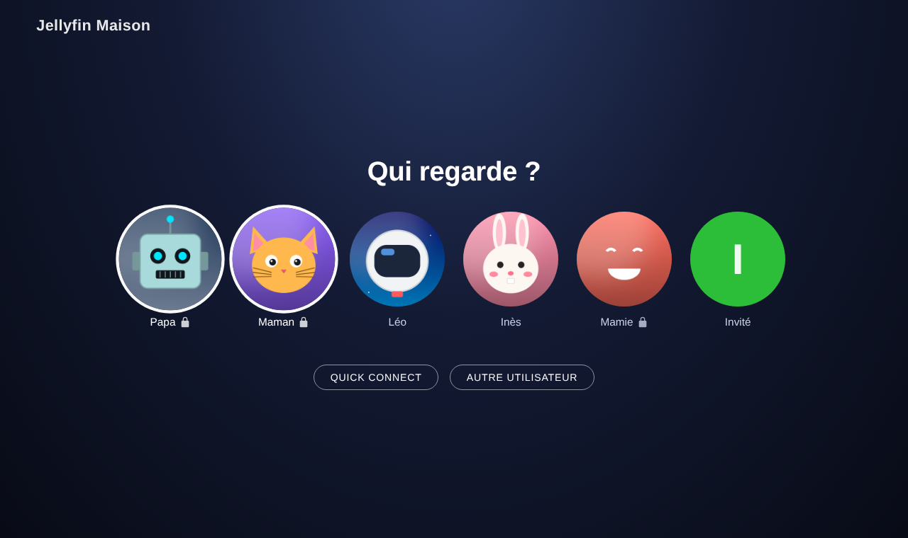
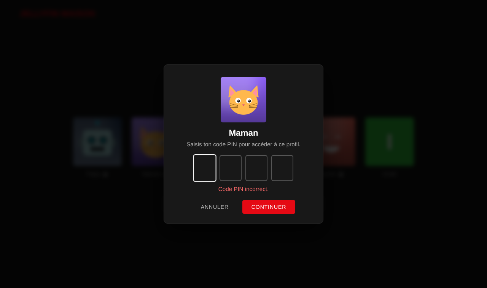
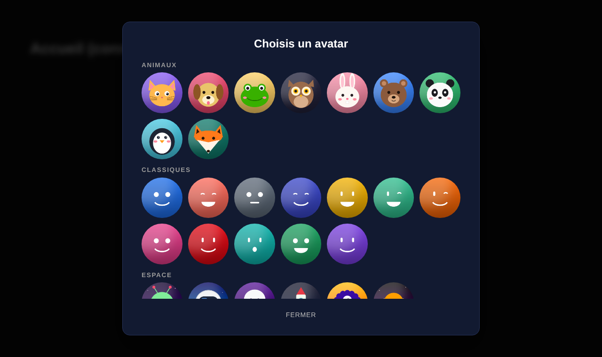

# Jellyfin Profile Picker

Écran **« Qui regarde ? »** façon plateformes de streaming pour la page de connexion de jellyfin-web, avec une **bibliothèque d'avatars prédéfinis** (33 intégrés + les tiens).

| Thème « Cinéma » | Thème « Bleu nuit » |
|---|---|
|  |  |

| PIN | Sélecteur d'avatars |
|---|---|
|  |  |

## Fonctionnalités

- Grille de profils plein écran à la place de la page de login (utilisateurs « visibles sur l'écran de connexion »).
- Clic sur un profil sans mot de passe → connexion directe. Profil protégé → fenêtre mot de passe **ou code PIN** (4 à 8 chiffres).
- L'authentification passe par **le formulaire natif** de jellyfin-web : le plugin ne voit et ne stocke aucun mot de passe.
- 2 thèmes (fond noir / avatars carrés, dégradé bleu nuit / avatars ronds), titre et couleur d'accent configurables.
- Boutons « Autre utilisateur » (formulaire classique) et Quick Connect.
- **Avatars prédéfinis** : 33 avatars originaux (classiques, animaux, robots, espace) embarqués dans la DLL.
- **Avatars personnalisés** : upload depuis le tableau de bord (PNG/JPEG/WEBP/GIF, 3 Mo max).
- Page d'admin : assigner un avatar à chaque utilisateur, masquer/afficher un profil de l'écran, état de l'injection.
- Bouton « Avatar prédéfini » sur la page Profil de chaque utilisateur (désactivable).

## Compatibilité

| Jellyfin | .NET | Paquet publié |
|---|---|---|
| 12.x | net10.0 | `X.Y.Z.1` (targetAbi 12.0.0.0) |
| 10.11.x | net9.0 | `X.Y.Z.0` (targetAbi 10.11.0.0) |

Le serveur choisit automatiquement le bon build depuis le dépôt.
Côté clients : jellyfin-web (navigateur, Jellyfin Media Player, apps Android/iOS qui embarquent le web). Les clients natifs (Android TV, Swiftfin, Infuse…) ont leur propre écran de connexion et ne sont pas concernés.

## Installation

### Via le dépôt de plugins (recommandé)

1. Tableau de bord → **Plugins** → **Dépôts** → **+**
   - Nom : `Profile Picker`
   - URL : `https://raw.githubusercontent.com/<OWNER>/jellyfin-plugin-profile-picker/main/manifest.json`
2. **Catalogue** → *Profile Picker* → Installer.
3. Redémarrer Jellyfin, puis **Ctrl+F5** dans le navigateur.

### Manuelle

Décompresser le zip de la [release](../../releases) dans `<config>/plugins/ProfilePicker_X.Y.Z.N/` puis redémarrer.
Sur Synology (paquet SynoCommunity) le dossier `plugins` est dans le répertoire de données du paquet (visible dans *Tableau de bord → Paramètres → Chemins*).

## Comment le script est chargé

jellyfin-web n'a pas d'API d'extension côté client : au démarrage, le plugin ajoute dans `index.html` de jellyfin-web un bloc balisé :

```html
<!-- ProfilePicker:start --><link rel="stylesheet" href="../ProfilePicker/Client/profile-picker.css?v=…"><script defer src="../ProfilePicker/Client/profile-picker.js?v=…"></script><!-- ProfilePicker:end -->
```

- Le bloc est **ré-appliqué à chaque démarrage** (les mises à jour Jellyfin écrasent `index.html`) et **retiré à la désinstallation** ou si tu désactives le plugin.
- Chemins relatifs → compatible avec une *BaseUrl* (`/jellyfin`) et un reverse proxy.
- Cohabite avec d'autres plugins qui injectent du JS (Jellyfin-Enhanced, etc.) : seul le bloc balisé est modifié.

**Si l'état affiche « index.html non modifiable »** (le compte du service n'a pas les droits sur le dossier web, conteneur en lecture seule…), deux options :

1. Donner l'écriture au compte du service sur `index.html` (chemin affiché dans la page du plugin), ex. sur Linux : `chown jellyfin: /usr/share/jellyfin/web/index.html`.
2. Ou décocher *Injection automatique* et utiliser le plugin **JavaScript Injector** avec :

```js
const css = document.createElement('link'); css.rel = 'stylesheet'; css.href = '../ProfilePicker/Client/profile-picker.css'; document.head.appendChild(css);
const js = document.createElement('script'); js.src = '../ProfilePicker/Client/profile-picker.js'; document.head.appendChild(js);
```

## API

| Méthode | Route | Accès |
|---|---|---|
| GET | `/ProfilePicker/Client/{profile-picker.js\|.css}` | anonyme |
| GET | `/ProfilePicker/Config` | anonyme (config d'affichage uniquement) |
| GET | `/ProfilePicker/Avatars` · `/ProfilePicker/Avatars/{id}` | anonyme |
| POST | `/ProfilePicker/Avatars?name=…` (corps = image brute) | admin |
| DELETE | `/ProfilePicker/Avatars/{id}` | admin |
| GET | `/ProfilePicker/Status` · POST `/ProfilePicker/Inject` | admin |

L'application d'un avatar à un utilisateur passe par l'API standard Jellyfin (`POST /UserImage?userId=…`) avec les droits de la session : un utilisateur ne peut changer que le sien, un admin ceux de tout le monde.

## Sécurité — à lire si le serveur est exposé sur Internet

- L'écran utilise `GET /Users/Public`, la même route que la page de login native : **les noms des profils visibles sont publics**. Masque les comptes sensibles (admin) via *Masquer cet utilisateur des écrans de connexion* (case « Visible sur l'écran » dans la page du plugin).
- Un PIN 4 chiffres = 10 000 combinaisons. Garde le verrouillage Jellyfin (*Nombre max. de tentatives de connexion échouées*) actif et réserve le mode PIN aux comptes non-admin ; les comptes admin doivent garder un vrai mot de passe et rester masqués.
- Derrière un reverse proxy, ajoute du rate-limiting / fail2ban sur `/Users/AuthenticateByName`.

## Développement

```bash
# build Jellyfin 12 (défaut) ou 10.11
dotnet build src/Jellyfin.Plugin.ProfilePicker -c Release
dotnet build src/Jellyfin.Plugin.ProfilePicker -c Release -p:JellyfinTarget=10.11

# régénérer les avatars intégrés (Pillow)
python3 tools/generate_avatars.py
```

Ajouter des avatars intégrés : déposer des PNG carrés dans `src/Jellyfin.Plugin.ProfilePicker/Avatars/<categorie>/<nom>.png` (noms en minuscules, sans espace ni point).

### Publier une version

```bash
git tag v1.0.0 && git push origin v1.0.0
```

Le workflow *Release* compile les deux cibles, crée la release GitHub avec les zips et met à jour `manifest.json` sur `main` (checksums MD5 inclus).

## Licence

GPL-3.0 (comme Jellyfin). Les avatars intégrés sont des créations originales générées par `tools/generate_avatars.py`, distribuées sous la même licence. Projet non affilié à Jellyfin ni à une quelconque plateforme de streaming.
